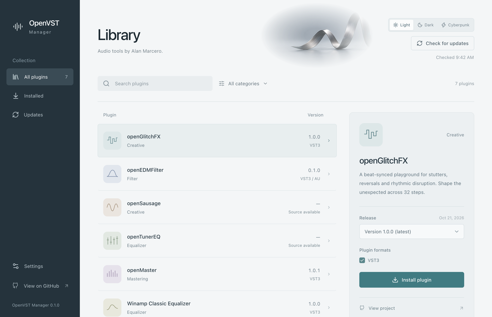
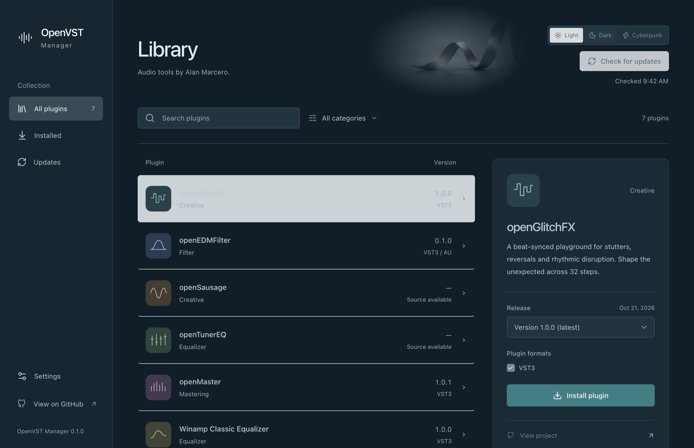
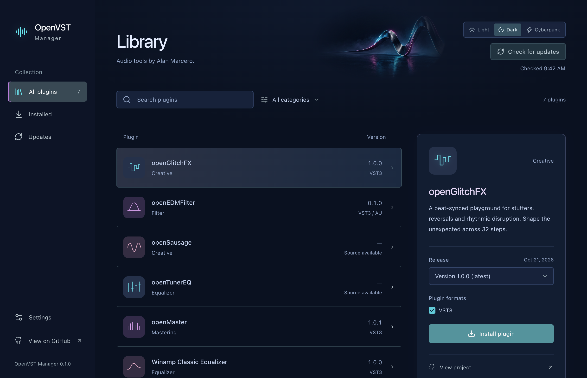

# OpenVST Manager

A quiet home for Alan Marcero's audio plugins. Browse releases, install the formats you use, and keep your collection current.

[Download for macOS or Windows](https://github.com/alanmarcero/alan-m-OpenVSTManager/releases/latest)



- Install VST3 plugins and available Audio Units directly from public GitHub Releases.
- See installed versions, update all managed plugins, or choose an older release.
- Search the library, choose custom installation folders, and remove managed installations.
- Switch between Light, Dark, and Cyberpunk from the main page.
- Browse cached releases offline. No account, token, subscription, or background service.

The catalog includes openEDMDelay, openWallLimiter, openDucker, openGlitchFX, openEDMFilter, openSausage, openTunerEQ, openMaster, Winamp Classic Equalizer, and Winamp Classic Visualizer. Each plugin links to its source and release notes. Download availability depends on its published releases and your platform.

<details>
<summary>Dark and Cyberpunk previews</summary>




[Generated cyberpunk studio artwork](public/artwork/cyberpunk-studio.png)
</details>

## Install the manager

**macOS:** download the `arm64.dmg` for Apple Silicon or `x64.dmg` for Intel, then drag OpenVST Manager into Applications. Current builds are ad-hoc signed, not Apple-notarized. macOS may require opening System Settings → Privacy & Security → Open Anyway after the first launch attempt. macOS 13 or later is required. If macOS reports the downloaded app as damaged, verify its checksum against `SHA256SUMS.txt` before clearing quarantine for this app only:

```sh
xattr -dr com.apple.quarantine '/Applications/OpenVST Manager.app'
```

**Windows:** run the x64 setup EXE. The current build has no publisher certificate, so SmartScreen may show a warning. Check that you downloaded it from this repository before proceeding. Windows 10 or later is required.

**Linux:** build the manager from source; no prebuilt Linux manager binaries are published.

## Plugin folders

| System | VST3 default | Audio Units |
| --- | --- | --- |
| macOS | `~/Library/Audio/Plug-Ins/VST3` | `~/Library/Audio/Plug-Ins/Components` |
| Windows | `%LOCALAPPDATA%/Programs/Common/VST3` (default) or `C:\Program Files\Common Files\VST3` | Not supported |
| Linux | `~/.vst3` | Not supported |

Settings allows choosing between standard installation folder options (including the default user folder and `C:\Program Files\Common Files\VST3` on Windows) or specifying a custom directory. Add that folder to your DAW's VST3 search paths, or choose a writable folder your DAW already scans. Close your DAW before replacing plugins and rescan afterward. The manager does not elevate privileges. Some older DAWs require a system-wide VST3 location; use your DAW's supported installation method if its folders require administrator access.

Existing external plugins are shown with an unknown version and are not overwritten or removed. Move an external copy yourself before installing a managed copy. When changing the installation folder, old managed files remain tracked and are moved on the next installation/update. Removal uses receipts and file ownership checks, never broad folder deletion.

ZIP downloads are checked against GitHub's SHA-256 digest when supplied. Extraction rejects path traversal, symlinks, conflicting names and oversized archives. Replacements are staged with rollback; installation receipts record the exact version and paths. A validated transaction journal recovers interrupted replacements or removals on the next launch.

## Build and run

Install Node.js 22.12+ (24 recommended) and Git:

```sh
git clone https://github.com/alanmarcero/alan-m-OpenVSTManager.git
cd alan-m-OpenVSTManager
npm ci
npm start
```

`npm run dev` serves a browser preview. Installation requires the desktop app.

```sh
npm run check        # core tests, TypeScript and frontend build
npx playwright install chromium
npm run test:ui      # theme, layout and interaction regressions
npm run test:desktop # live macOS/Electron install/remove smoke test, isolated temp folders
npm run dist:mac     # macOS arm64 + x64 DMGs, on macOS
npm run dist:win     # Windows x64 setup EXE, on Windows
npm run dist:linux   # local AppImage and tar.gz, on Linux
```

On Debian/Ubuntu desktop systems, Electron needs GTK, NSS, X11 and audio runtime libraries. Ubuntu 24.04 example:

```sh
sudo apt-get install libgtk-3-0t64 libnss3 libasound2t64 libgbm1 libxss1 libxtst6 libfuse2t64
npm ci
npm run dist:linux
```

Use a normal desktop session. Do not disable Electron's sandbox. If an AppImage cannot mount, run it with `--appimage-extract-and-run` or use the tar.gz. Linux users build plugins from their individual source repositories when no compatible Linux release asset exists; the manager links directly to each project.

## Command line

The source checkout includes the same manager core without a window:

```sh
npm run cli -- list
npm run cli -- install openMaster --format VST3
npm run cli -- install openMaster --version v1.0.0 --format VST3
npm run cli -- uninstall openMaster --format VST3
npm run cli -- paths
npm run cli -- paths VST3 /absolute/path/to/plugins
```

Use `--data-dir /absolute/path` for isolated CLI settings and receipts. The desktop app also accepts the `OPENVST_DATA_DIR` environment variable. Do not run the CLI and desktop app against the same settings directory concurrently.

Settings, receipts, cache and a bounded activity log live in Electron's user-data directory: `~/Library/Application Support/OpenVST Manager` on macOS, `%APPDATA%/OpenVST Manager` on Windows, and `$XDG_CONFIG_HOME/OpenVST Manager` (normally `~/.config/OpenVST Manager`) on Linux. Theme choice is stored in the local renderer profile.

## Releases and catalog

GitHub Actions tests each push and builds macOS and Windows packages. Push a `v*` tag matching package.json to publish both platforms and checksums together. Linux runs the core/build checks but has no release binaries. Native plugin release workflows and verification are recorded in [the plugin release audit](docs/plugin-release-audit.md).

`catalog.json` is bundled and refreshed from this public repository. To add a plugin, add its repository name, exact bundle names and description, then publish compatible ZIP release assets. Asset names identify `macOS` (universal), `Windows` (x64), or `Linux` (x64); architecture-specific assets use `arm64`, `aarch64`, `x64` or `x86_64`. Format-specific archives include `VST3` or `AU` in the name; multi-format archives can contain both bundles at any depth. Only releases under `github.com/alanmarcero/` are accepted. The newest 100 releases are available for version selection.

## Credits

Inspired by [The Usual Suspects Plugin Manager](https://theusualsuspects.io/downloads/plugin-manager) and its [Gearmulator source](https://github.com/dsp56300/gearmulator/tree/main/source/framework/tools/installer). This is an independent implementation with original interface and graphics. See [third-party credits](THIRD_PARTY.md) and [artwork prompts](assets/ARTWORK.md). The manager is MIT licensed; plugins retain their own terms.
